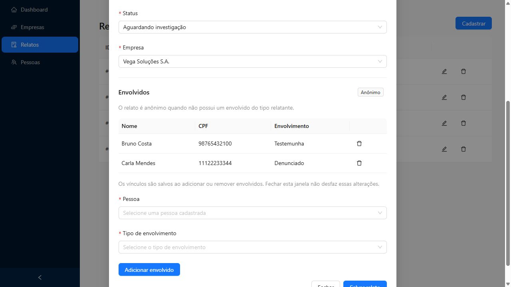
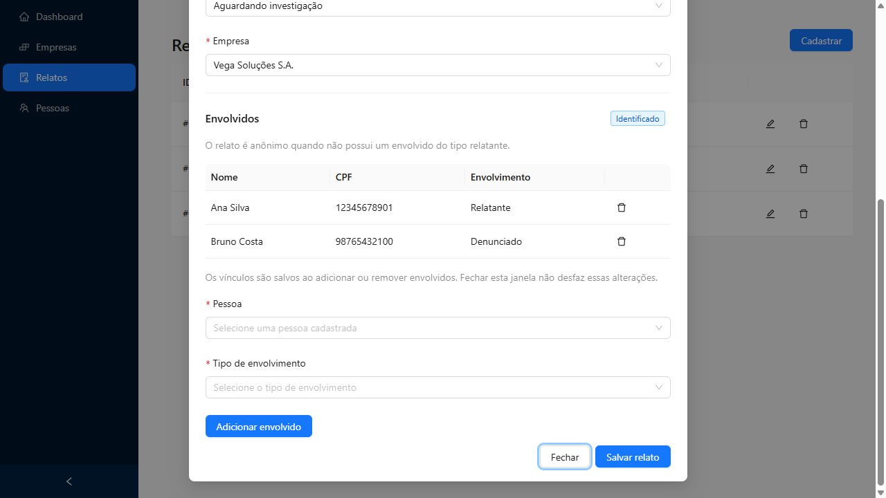

# Validação de envolvidos em relatos

Data: 01/11/2026.

Ambiente local com Docker: front-end em `https://localhost:5100` e API em `http://localhost:8080`.

Foi criado um relato temporário para validar as alterações sem modificar os relatos de exemplo. As pessoas usadas são os dados fictícios fornecidos pelo projeto. Ao concluir, o relato temporário e seus vínculos ativos foram removidos pela API.

## Cenários validados

| O que foi testado | Como foi testado | Resultado esperado | Resultado obtido |
| --- | --- | --- | --- |
| Relato sem envolvidos | Abrir a edição do relato temporário, sem vínculos. | Lista vazia e indicação de anônimo após carregar a resposta da API. | Lista vazia e indicação “Anônimo”. |
| Campos obrigatórios | Clicar em “Adicionar envolvido” sem preencher pessoa e tipo. | Exibir as duas validações, sem criar um vínculo. | Exibidas as mensagens de pessoa e tipo obrigatórios. |
| Tipos disponíveis | Abrir a seleção de tipo de envolvimento. | Disponibilizar relatante, testemunha, vítima e denunciado. | Os quatro tipos apareceram em português. |
| Inclusão de testemunha | Selecionar Bruno Costa e o tipo Testemunha, depois adicionar. | Exibir o vínculo e manter o relato anônimo. | Bruno foi exibido como Testemunha. A API retornou `is_anonymous: true` e a tela manteve “Anônimo”. |
| Inclusão de relatante | Selecionar Ana Silva e o tipo Relatante, depois adicionar. | Exibir a pessoa e atualizar o relato para identificado. | Ana foi exibida como Relatante. A API retornou `is_anonymous: false` e a tela mostrou “Identificado”. |
| Persistência dos vínculos e separação do formulário de relato | Alterar o título sem salvar, fechar a janela e reabrir o relato. Conferir também os dados na API. | Preservar os vínculos salvos e descartar a alteração não salva do título. | Os dois vínculos permaneceram e o título original foi preservado. |
| Vínculo duplicado com dados desatualizados | Selecionar Carla como Vítima na interface. Antes de adicionar, criar um vínculo de Carla como Denunciado pela API, simulando outra sessão. Depois, enviar o formulário da interface. | A API rejeitar a duplicata e a tela informar o conflito. | Retorno 409, mensagem “Esta pessoa já está envolvida neste relato.” e atualização da lista, mostrando Carla como Denunciado. A seleção de pessoa foi limpa. |
| Remoção e anonimato | Na interface, remover Ana do relato temporário e confirmar. | Remover somente o vínculo, preservar os demais envolvidos e atualizar o anonimato. | Ana deixou a lista. Bruno e Carla permaneceram. A API retornou `is_anonymous: true` e a tela mostrou “Anônimo”. |
| Salvamento dos dados do relato | Alterar o título e clicar em “Salvar relato”. Consultar o relato e os envolvidos na API. | Salvar o título e preservar os vínculos existentes. | A janela fechou, o título foi salvo e os dois vínculos restantes foram preservados. |
| Troca de relato | Após concluir a validação temporária, abrir a edição do relato de exemplo nº 1. | Carregar os envolvidos daquele relato, sem reutilizar os dados do anterior. | Carregados os vínculos de Ana como Relatante e Bruno como Denunciado, com indicação de identificado. |

## Evidências visuais

Relato sem relatante, após a remoção:

Relato de exemplo com relatante:

## Verificações de código

- ESLint de todo o cliente com `pnpm exec eslint . --max-warnings 0`: passou sem erros ou avisos.
- Build completo com `pnpm run build`: passou, incluindo a checagem de TypeScript. O Vite mantém um aviso sobre o tamanho do bundle, sem impedir a geração.
- Testes com `pnpm test`: os sete testes passaram.
- O bloqueio anterior em `service.helper.test.ts` foi corrigido. `handleServiceError` agora exige apenas `notification.error`, que é o método utilizado pela função. Os testes simulam essa dependência sem precisar implementar toda a estrutura do Ant Design.

## Limitação encontrada na API

Foi testada também, pela API, a reinclusão de Ana no mesmo relato temporário após remover seu vínculo. O servidor retornou 500 (`SERVER_ERROR`). O vínculo usa exclusão lógica, mas o banco mantém um índice único para `record_id` e `person_id`, impedindo a criação de outro registro para a mesma combinação.

O front-end trata esse retorno como falha e não apresenta sucesso. A correção da reinclusão depende do back-end. Nenhum arquivo de `server/` foi alterado.

## Cenários ainda não executados

Os estados de falha de carregamento, os botões de tentar novamente, a ausência de pessoas cadastradas e a consulta de um vínculo cuja pessoa foi excluída estão tratados na interface, mas não foram simulados nesta rodada. As evidências do épico de Pessoas estão em [people-validation.md](people-validation.md).
