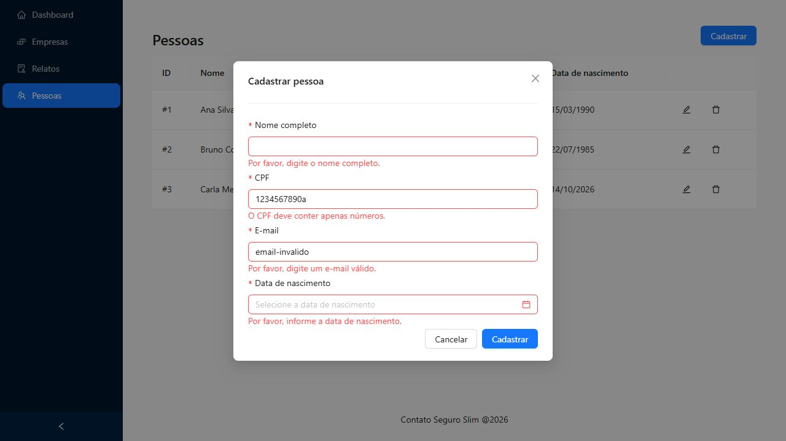
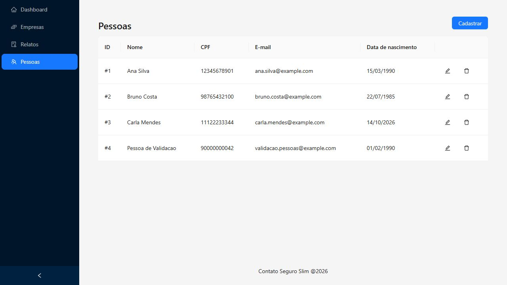
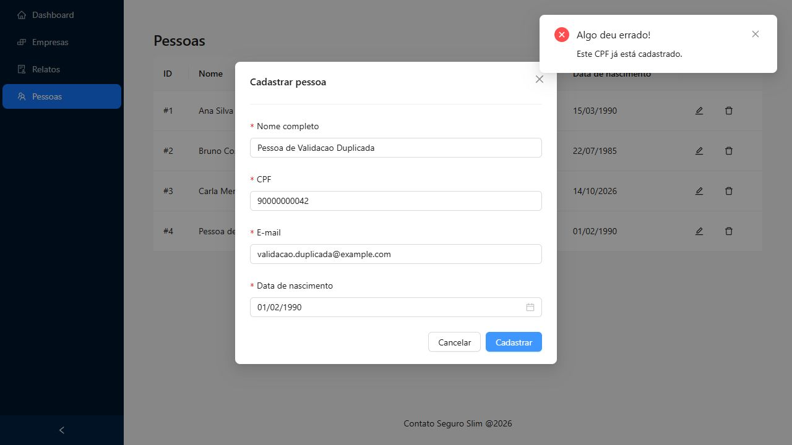
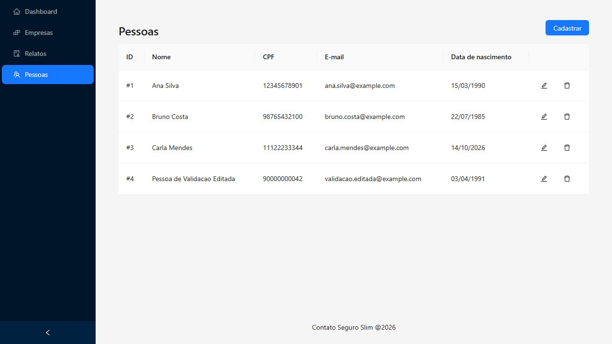
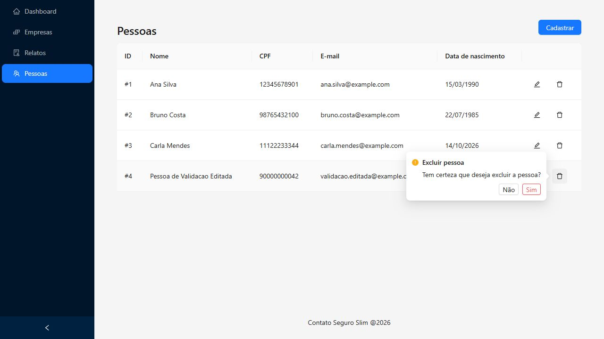
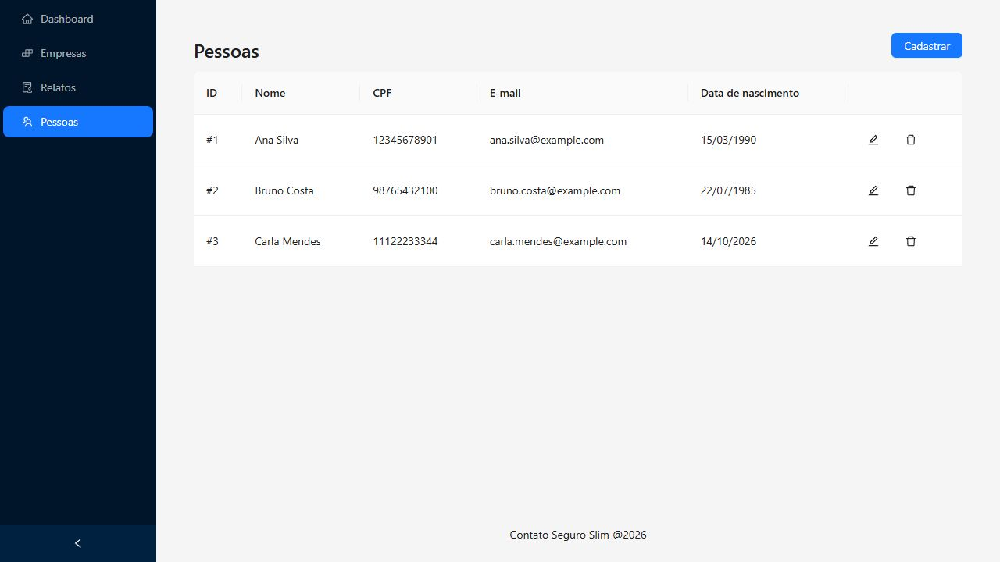

# Validação de Pessoas

Data: 01/11/2026.

Ambiente local com Docker: front-end em `https://localhost:5100/people` e API em `http://localhost:8080`.

Os cenários foram executados pela interface, com consultas à API para conferir persistência e unicidade. Foi criada apenas uma pessoa fictícia para os testes, sem alterar as pessoas já cadastradas pelo usuário. Ao concluir, a pessoa temporária foi excluída pela própria interface.

## Dados usados

- Nome inicial: Pessoa de Validacao.
- CPF fictício: `90000000042`.
- E-mail inicial: `validacao.pessoas@example.com`.
- Nascimento inicial: `01/02/1990`.
- Dados após editar: Pessoa de Validacao Editada, `validacao.editada@example.com` e `03/04/1991`.

## Cenários validados

| O que foi testado | Como foi testado | Resultado esperado | Resultado obtido |
| --- | --- | --- | --- |
| Campos obrigatórios | Abrir “Cadastrar” e enviar o formulário vazio. | Exibir validação de nome, CPF, e-mail e data de nascimento. | Os quatro campos exibiram suas mensagens de preenchimento obrigatório. |
| Nome com espaços | Preencher o nome somente com espaços e tentar cadastrar. | Impedir o envio e solicitar o nome completo. | Exibida a mensagem “Por favor, digite o nome completo.” |
| CPF com menos de 11 dígitos | Preencher o CPF com `123` e tentar cadastrar. | Impedir o envio por tamanho inválido. | Exibida a mensagem “O CPF deve ter 11 dígitos.” |
| CPF com letras | Preencher o CPF com `1234567890a` e tentar cadastrar. | Impedir o envio por formato inválido. | Exibida a mensagem “O CPF deve conter apenas números.” |
| E-mail inválido | Preencher o e-mail com `email-invalido` e tentar cadastrar. | Impedir o envio e informar formato inválido. | Exibida a mensagem “Por favor, digite um e-mail válido.” |
| Cadastro com sucesso | Preencher os dados fictícios válidos e clicar em “Cadastrar”. Conferir também a listagem da API. | Fechar o modal, exibir a pessoa na tabela e persistir seus dados. | Pessoa criada com ID 4, exibida na tabela com `01/02/1990`. A API retornou a data `1990-02-01` e os demais dados preenchidos. |
| Persistência ao navegar | Depois do cadastro, abrir Empresas e voltar para Pessoas. | Carregar novamente a pessoa salva. | A pessoa continuou na listagem após remontar a tela. |
| CPF duplicado no cadastro | Abrir outro cadastro com o mesmo CPF da pessoa temporária, outro nome e outro e-mail válidos. | Rejeitar o cadastro e informar a duplicidade. | Exibida a mensagem “Este CPF já está cadastrado.” O modal permaneceu aberto e não foi criada uma segunda pessoa. |
| Preenchimento da edição | Abrir a edição da pessoa temporária. | Mostrar os dados já salvos, incluindo a data. | Nome, CPF, e-mail e data apareceram preenchidos corretamente. |
| CPF duplicado na edição | Na pessoa temporária, tentar usar o CPF de Ana Silva, `12345678901`. | Rejeitar a alteração e manter o CPF original no banco. | Exibida a mensagem “Este CPF já está cadastrado.” A edição válida seguinte confirmou que havia somente um registro ativo com o CPF temporário. |
| Edição com sucesso | Restaurar o CPF temporário, alterar nome, e-mail e data de nascimento, e clicar em “Confirmar”. Consultar a API. | Atualizar a pessoa existente e a tabela, sem criar outra pessoa. | O ID continuou 4. Nome e e-mail foram atualizados. A tabela mostrou `03/04/1991` e a API retornou `1991-04-03`. |
| Cancelamento da exclusão | Abrir a confirmação de exclusão da pessoa temporária e escolher “Não”. | Preservar a pessoa. | A pessoa permaneceu na tabela e a confirmação pôde ser aberta novamente. |
| Exclusão com confirmação | Abrir novamente a confirmação e escolher “Sim”. Consultar a listagem e a busca por ID na API. | Remover a pessoa da listagem. | A pessoa saiu da tabela e da listagem da API. A busca pelo ID 4 retornou 404. As três pessoas que já existiam permaneceram cadastradas. |

## Evidências visuais

Validação dos campos:

Cadastro concluído:

CPF duplicado:

Edição concluída:

Confirmação da exclusão:

Listagem após excluir os dados temporários:

## Verificações de código

- `pnpm run build`: passou.
- `pnpm test`: sete testes passaram.
- `pnpm exec eslint . --max-warnings 0`: passou.

Os comandos foram executados no container `frontend`. O build emite um aviso de tamanho do bundle, sem impedir a geração. As exceções pontuais de Fast Refresh nos contextos seguem o mesmo padrão usado nos contextos de Empresas e Relatos.

## Limites desta validação

Foram validados o formato de 11 dígitos exigido pelo contrato da API e os conflitos com CPFs já cadastrados. Não foi adicionada validação de dígitos verificadores.

Não foram simuladas falhas de rede, nem a tentativa de cadastrar novamente um CPF após excluir sua pessoa. A exclusão de uma pessoa que já possui envolvimentos também não foi executada, para preservar os dados existentes.
